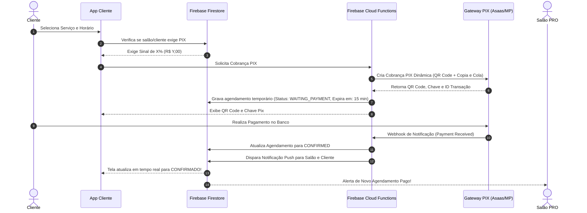

# 🧠 MEMÓRIAS E CONTEXTO COMPLETO DO PROJETO - AGENDEI PRO

> **Documento Mestre de Memória Viva e Contexto Geral**  
> *Data da última consolidação:* 06 de Setembro de 2026  
> *Objetivo:* Servir como o histórico definitivo, técnico e de produto de tudo o que foi conversado, desenhado, corrigido e desenvolvido no ecossistema **Agendei PRO**.  
> **Aviso para qualquer assistente AI / Dev:** *Leia este documento na íntegra para assumir o contexto exato do repositório antes de realizar qualquer alteração.*

---

## 📱 1. Visão Geral e Arquitetura do Projeto

O **Agendei PRO** é uma solução completa para gestão e agendamento online de salões de beleza, barbearias, manicures, clínicas de estética e estúdios. O ecossistema é modularizado em um único repositório Android com múltiplos flavors e módulos:

```
Agendei_PRO/
├── core/                # Módulo biblioteca compartilhado (Modelos, Repositórios Firestore, Serviços)
├── app/                 # Módulo principal com 2 Flavors:
│   ├── client           # Agendei Cliente (com.example.agendei_pro.client) -> App do Cliente
│   └── pro              # Agendei PRO (com.example.agendei_pro) -> App do Salão / Profissional
├── admin/               # Módulo standalone do Administrador (com.example.agendei_admin) -> Retaguarda e Suporte
└── Agendei_Install/     # Diretório de distribuição dos APKs compilados prontos para instalação
```

### 🛠 Stack Tecnológica e Ambiente de Desenvolvimento:
* **Linguagem:** Kotlin 2.x
* **UI / Design System:** Jetpack Compose com Material Design 3 (M3), suporte a temas dinâmicos e layout responsivo.
* **Backend & Banco de Dados:** Google Firebase
  * **Firebase Authentication:** Login com Google Sign-In e credenciais federadas.
  * **Cloud Firestore:** Banco de dados NoSQL em tempo real (`snapshots listeners`).
  * **Firebase Cloud Messaging (FCM):** Notificações push em tempo real (tópicos `salons`, `clients` e `salon_{id}`).
  * **Firebase Storage:** Armazenamento de logotipos, fotos de perfil e comprovantes.
* **Carregamento de Imagens:** Coil 3 (`AsyncImage`).
* **Arquitetura de Código:** MVVM (Model-View-ViewModel) reativo com Kotlin Coroutines, `StateFlow` e `SharedFlow`.
* **Ambiente de Build:**
  * **JDK:** OpenJDK 17 (`/home/arnaldo/.android_build_env/jdk-17`)
  * **Android SDK:** `/home/arnaldo/.android_build_env/android-sdk`
  * **Comando de Compilação:** `export JAVA_HOME=/home/arnaldo/.android_build_env/jdk-17 && export PATH=$JAVA_HOME/bin:$PATH && ./gradlew assembleDebug`
  * **Destino dos APKs:**
    * `Agendei_Cliente.apk` (App do Cliente)
    * `Agendei_Salao.apk` (App do Salão PRO)
    * `Agendei_Admin.apk` (App do Administrador/Suporte)

---

## 🚀 2. Módulos e Funcionalidades Implementadas

### 2.1. 📱 Módulo do Cliente (`Agendei_Cliente`)
1. **Vinculação a Salões:**
   * Conexão simples através do código alfanumérico único do salão ou link compartilhado via WhatsApp.
   * Suporte a múltiplos salões vinculados na conta do cliente com troca rápida no topo.
2. **Fluxo de Agendamento Inteligente (`SchedulingScreen`):**
   * Seleção de serviço, profissional (ou *"Tanto faz"* para encontrar o primeiro horário livre).
   * Grade de horários dinâmica com cálculo de duração (serviços de 60min consomem múltiplos slots de 30min).
   * Detecção e prevenção em tempo real de choque de horários (`overlap`) e bloqueio de horários fora do expediente ou durante o almoço.
3. **Cartão Fidelidade / Fidelômetro (`ClientDashboardScreen`):**
   * Acúmulo de selos a cada atendimento concluído.
   * Alertas automáticos de prêmios disponíveis (ex: *"Corte Grátis"*) com prazo de validade configurado pelo salão.
   * Opção de resgate do prêmio diretamente na tela de agendamento.
4. **Histórico & Avaliações (`ClientAppointmentsScreen`):**
   * Abas compactas de *Próximos* e *Histórico*.
   * Avaliação por estrelas (1 a 5), comentários e botão para favoritar o colaborador.
   * Adição rápida do compromisso na Agenda do Google/Android (`CalendarContract`).
   * Cancelamento com respeito à política de antecedência mínima configurada pelo salão.
5. **Reagendamento Rápido:**
   * Card na tela inicial permitindo reagendar com 1 toque o último serviço realizado.
6. **Perfil & Segurança:**
   * Sanitização rigorosa de telefone e máscara dinâmica `(XX) XXXXX-XXXX` sem duplicar caracteres.
   * Notificação instantânea se o salão bloquear o cadastro do cliente (com travamento de agendamentos).

---

### 2.2. 💈 Módulo do Profissional / Salão (`Agendei_Salao` / `Agendei_PRO`)
1. **📅 A Nova Agenda Diária Timeline ("Estilo Shelton" - `AgendaScreen`):**
   * **Seletor de Data Pop-up (`Sáb. 22.08 ▼`):** Ao tocar no cabeçalho central, abre um calendário mensal pop-up com **marcadores circulares azuis** nos dias que possuem clientes agendados.
   * **Botão "Hoje":** Retorna imediatamente para a data atual.
   * **Abas de Status Anti-Poluição:**
     * `Todos`: Linha do tempo completa de horários e blocos ativos do dia.
     * `Pendentes`: Filtro focado em solicitações com badge numérico de alertas.
     * `Cancelados`: Aba isolada para agendamentos cancelados, mantendo a tela de atendimento 100% limpa.
   * **Timeline Diária em Slots (`08:00`, `08:30`, `09:00`...):**
     * **Marcador "Agora" (Linha Vermelha):** Exibe a linha do tempo exata com horário atual em tempo real.
     * **Agendamento Confirmado:** Card azul escuro de alto contraste com nome do cliente em destaque negrito, serviço, duração, botão de WhatsApp direto e botão de concluir atendimento.
     * **Agendamento Pendente:** Card âmbar com botões de *Aceitar* e *Recusar*.
     * **Bloqueio de Horário:** Card grafite elegante com ícone de Café ☕, Almoço ou Ausência e botão de lixeira para desbloquear com 1 toque.
     * **Horário Livre:** Slot fino com botão rápido para bloquear.
2. **☕ Bloqueio de Horário com Recorrência (`AgendaViewModel`):**
   * Bloqueio pontual ou recorrente configurável:
     * *Apenas hoje (1x)*
     * *Diariamente* por 7, 30, 60 ou **100 dias** (ex: bloquear o café das 15h às 15h30).
     * *Toda semana no mesmo dia* por 4, 8, 12 ou 16 semanas.
3. **📋 "Meus Agendamentos" no App PRO (`ClientAppointmentsScreen` / `MainActivity`):**
   * Resumo rápido do dia para o barbeiro ("O que eu tenho pra hoje?").
   * Abas: **Hoje**, **Próximos** e **Histórico** com consulta direta aos atendimentos do salão.
4. **Gestão de Equipe & Profissionais (`ManageTeamScreen`):**
   * Cadastro de colaboradores com busca automática da foto de perfil via conta Google/e-mail.
   * Suporte a horários personalizados por profissional (`hasCustomSchedule`) ou herança das regras gerais do salão.
5. **Carteira de Clientes (`SalonClientsScreen`):**
   * Cards compactos para alta densidade de visualização.
   * Ação rápida de WhatsApp, controle de selos fidelidade acumulados e resgate manual de prêmios.
   * Bloqueio/Desbloqueio de clientes indisciplinados ou inadimplentes.
6. **Fila de Espera Automática (`SalonWaitingListScreen` / `WaitingRepository`):**
   * Clientes entram na lista de espera para datas lotadas.
   * Ao ocorrer um cancelamento, o sistema notifica automaticamente os clientes da fila.
7. **Desempenho & Finanças (`SalonPerformanceScreen`):**
   * Faturamento diário, mensal e anual, ticket médio, serviços mais lucrativos e metas financeiras.
8. **Promoção do Salão (`SalonPromotionScreen`):**
   * Criação de avisos para os clientes em formato de **Banner** no topo ou **Pop-up (Aviso)** na abertura do app.
9. **Ajustes do Salão (`SalonSettingsScreen`):**
   * Configuração de expediente, intervalo de almoço, tempo de antecedência mínima para agendar/cancelar, logomarca redonda ou retangular, fidelidade e regras de aceitação automática.

---

### 2.3. 🛠 Módulo Administrador (`Agendei_Admin`)
1. **Retaguarda e Gestão Global:**
   * Listagem de todos os salões cadastrados no Brasil, status de assinatura e dias restantes de trial.
   * Gerenciamento de valores dos planos (Bronze, Prata, Ouro).
2. **Suporte Técnico Híbrido com Triagem FAQ:**
   * Chat de suporte em tempo real com categorização em 8 temas.
   * Sistema de contadores de mensagens não lidas por salão/cliente (`unreadCount`).
   * Escalonamento para atendimento humano com finalização e reabertura de chamados.
3. **Comunicados Globais (`AdminBroadcastScreen`):**
   * Envio de alertas globais por push, banner ou pop-up para toda a base de usuários.

---

### 2.4. 🎨 Sistema de Temas e Identidade Visual
* **Temas Suportados:** *Luxo Dourado*, *Barbearia Vintage*, *Rosa Quartzo*, *Oceano Profundo*, *Dark Modern*, *Minimalista Claro*, etc.
* **Persistência Permanente:** Salvo no `SharedPreferences` (`theme_prefs`). Não reseta ao fechar o app.
* **Ícones Customizados:** Gerados com logo oficial e borda dourada para o PRO (`agendeipro.png`) e Cliente (`agendei.png`).

---

## 💡 3. Planejamento da Nova Demanda: Pagamentos via PIX

A proposta consiste em adicionar uma camada financeira automatizada para mitigar o problema de faltas de clientes (*"no-shows"*) e habilitar pagamentos integrados.

### 3.1. Regras de Negócio Definidas:
1. **Configuração Flexível por Salão:**
   * O salão pode optar por habilitar ou não o PIX no app.
   * Pode exigir o pagamento de um **Sinal Percentual (ex: 20%, 30%, 50%) ou Integral (100%)** do valor do serviço para confirmar a reserva.
2. **Exigência de Sinal Segmentada (Clientes Faltosos / Lista de Risco):**
   * O salão pode manter o agendamento livre para clientes fiéis, mas **exigir o PIX obrigatório apenas para clientes específicos** (com histórico de cancelamentos de última hora ou faltas frequentes).
3. **Intermediação de Pagamentos Simples (Gateway / BaaS):**
   * Integração com intermediador com baixa burocracia e suporte a PIX dinâmico (principais candidatos: **Asaas**, **Mercado Pago**, **EFI / Gerencianet** ou **OpenPix**).

### 3.2. Arquitetura Técnica do Fluxo PIX:


---

## 🔮 4. Brainstorm: Migração .NET MAUI + DevExpress / Syncfusion

* **Contexto:** Análise de viabilidade para migração do projeto no ambiente corporativo (Visual Studio Enterprise + DevExpress / Syncfusion .NET MAUI).
* **Vantagens Analisadas:**
  * Componentes ricos prontos (Scheduler avançado estilo Outlook, Gráficos financeiros avançados, DataGrids com exportação Excel/PDF).
  * Suporte multiplataforma nativo (Android, iOS, Windows Desktop e macOS).
* **Considerações:**
  * O código Kotlin Jetpack Compose atual já entrega altíssima performance, layout 100% customizado e custo zero de licenciamento. A versão MAUI pode ser avaliada como uma futura versão Desktop/Web se houver demanda.

---

## ⚠️ 5. Regras Críticas e Diretrizes de Manutenção

> [!IMPORTANT]
> 1. **NÃO RESETAR O BANCO DE DADOS FIRESTORE:** Salões reais, profissionais e clientes já estão em fase de teste e homologação. Qualquer script de limpeza deve ser estritamente proibido sem consentimento prévio.
> 2. **Preservação de Mapeamentos Kotlin-Firestore:**
>    * Propriedades booleanas com prefixo `is` (ex: `isBlocked`) **DEVEM** conter as anotações `@get:PropertyName("isBlocked")` e `@field:PropertyName("isBlocked")` para evitar problemas de desserialização.
> 3. **Ambiente de Build:** Sempre exportar `JAVA_HOME=/home/arnaldo/.android_build_env/jdk-17` antes de invocar `./gradlew`.
> 4. **Distribuição:** Ao finalizar novas compilações, copie sempre os APKs finais para a pasta `Agendei_Install/`.

---

## 📊 6. Histórico de Versões e Entregas

| Data | Versão / Marcos | Principais Entregas |
| :--- | :--- | :--- |
| **09/07/2026** | v1.0.0 Alpha | Estrutura base Multi-módulo, Login Google, Agendamento e Gestão de Serviços. |
| **11/07/2026** | v1.1.0 Beta | Suporte técnico com triagem FAQ, Chat Admin, Cartão Fidelidade, Fila de Espera. |
| **16/08/2026** | v1.2.0 RC | Notificações foreground low, Bloqueio de clientes Firestore fix, Ícones adaptativos com borda dourada. |
| **22/08/2026** | v1.3.0 Shelton Release | **Nova Agenda Timeline Shelton**, Pop-up de calendário mensal com marcadores azuis, Abas *Todos/Pendentes/Cancelados*, Bloqueio recorrente de até 100 dias, Persistência de Temas, Meus Agendamentos no PRO. |
| **06/09/2026** | v1.3.1 Consolidação | Criação do documento unificado de memórias, preparação do ambiente e especificações completas do PIX. |
