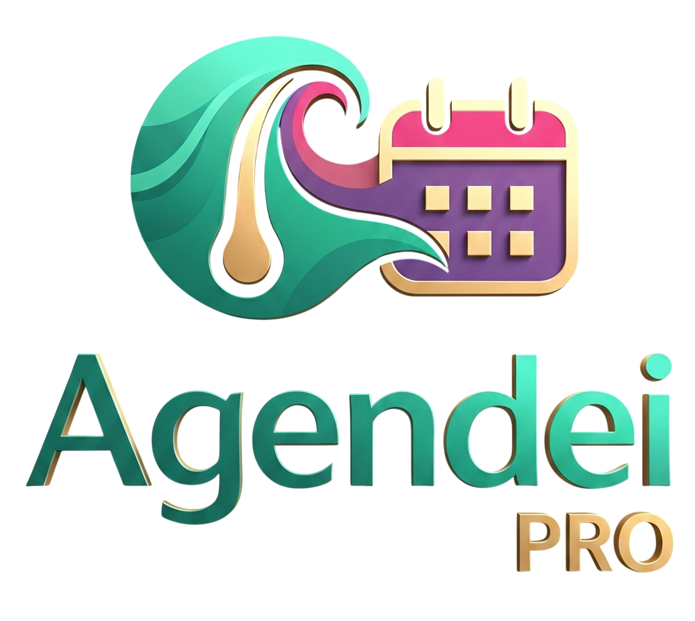

# 💈 Agendei PRO & Agendei Cliente

<p align="center">
  
</p>

<p align="center">
  <strong>Ecossistema Completo de Gestão e Agendamento Online em Tempo Real para Salões de Beleza, Barbearias e Estúdios</strong>
</p>

<p align="center">
  
  
  
  
  
</p>

---

## 📱 Visão Geral do Ecossistema

O **Agendei PRO** é uma solução mobile robusta, desenvolvida de forma nativa em **Kotlin** com **Jetpack Compose (Material Design 3)** e backend em nuvem reativo via **Google Firebase**. O projeto adota uma arquitetura multi-módulo inteligente com **Product Flavors**, compartilhando regras de negócio e modelos sem redundância de código:

```
Agendei_PRO/
├── core/                # Módulo biblioteca compartilhada (Modelos, Repositórios Firestore, Serviços de Notificação)
├── app/                 # Módulo principal dividido em 2 Flavors:
│   ├── client           # Agendei Cliente (com.example.agendei_pro.client) -> Focado no cliente final
│   └── pro              # Agendei PRO (com.example.agendei_pro) -> Painel completo do salão / barbeiro
├── admin/               # Módulo standalone do Administrador (com.example.agendei_admin) -> Retaguarda e Suporte
└── Agendei_Install/     # Diretório com os APKs oficiais compilados prontos para distribuição
```

---

## 🌟 Principais Recursos e Diferenciais

### 1. 💈 Aplicativo do Salão / Profissional (`Agendei PRO`)
* **📅 Nova Agenda Timeline Diária ("Estilo Shelton"):**
  * **Seletor de Data Pop-up (`Sáb. 22.08 ▼`):** Cabeçalho moderno que abre um diálogo mensal compacto com **marcadores azuis** destacando os dias com clientes agendados.
  * **Linha Vermelha de "Agora":** Indicador horizontal em tempo real marcando o horário exato no dia de hoje.
  * **Abas Anti-Poluição:** Filtros separados em *Todos* (grade do dia), *Pendentes* (com badge de notificações) e *Cancelados* (isolados para não atrapalhar a visão operacional).
  * **Blocos de Alto Contraste:** Cards azuis vibrantes com nome do cliente em destaque negrito, serviço, duração, atalho direto para WhatsApp e botão de concluir atendimento com 1 clique.
* **☕ Bloqueio de Horário com Recorrência:**
  * Bloqueie intervalos (Café ☕, Almoço, Consulta, Ausência) para hoje ou repetidos diariamente/semanalmente por **até 100 dias** automaticamente.
* **📋 "Meus Agendamentos" Exclusivo:**
  * Resumo rápido do dia para o profissional (*Hoje*, *Próximos* e *Histórico*) sem sobrecarga de tela.
* **👥 Gestão Completa de Equipe:**
  * Cadastro de colaboradores com busca assíncrona automática da foto oficial da conta Google via e-mail.
  * Horários e dias de trabalho individuais (`hasCustomSchedule`) ou herança do expediente padrão do salão.
  * Especialidade universal (*"🌟 Todos os Serviços"*).
* **🏆 Fidelômetro & Retenção:**
  * Controle de selos acumulados, configuração de validade e premiação automática no aceite do agendamento.
* **⏳ Fila de Espera Automática:**
  * Registro de clientes interessados em dias lotados com alertas automáticos em caso de cancelamentos.
* **📈 Desempenho & Finanças:**
  * Métricas de faturamento diário, mensal e anual, ticket médio e serviços mais demandados.
* **📣 Promoções e Avisos:**
  * Disparo de avisos aos clientes em formato de Banner superior ou Pop-up na inicialização do app.

---

### 2. 📱 Aplicativo do Cliente (`Agendei Cliente`)
* **🔗 Vinculação Rápida:**
  * Conexão a um ou mais salões via código único (`PRO-XXXXXX`) ou link compartilhado no WhatsApp.
* **⚡ Agendamento sem Conflitos (`No-Overlap`):**
  * Seleção de serviço, profissional preferido (ou *"Tanto faz"*) e verificação instantânea de múltiplos slots livres baseada na duração real do serviço.
* **🎯 Fidelidade Transparente:**
  * Acompanhamento visual da barra de progresso de selos e alerta de cortes/serviços grátis disponíveis para resgate direto no agendamento.
* **🔄 Reagendamento com 1 Toque:**
  * Card de atalho rápido na Home para repetir o último serviço realizado.
* **⭐ Avaliações & Favoritos:**
  * Avaliação por estrelas (1 a 5), comentários pós-atendimento e opção de favoritar profissionais da equipe.
* **🛡️ Sincronização de Bloqueio em Tempo Real:**
  * Caso o salão bloqueie um cliente por faltas recorrentes, a interface trava instantaneamente com alerta informativo em conformidade com as regras do salão.

---

### 3. 🛠 Aplicativo Administrador / Suporte (`Agendei Admin`)
* **🎧 Chat de Atendimento Híbrido:**
  * FAQ interativo com bot em 8 categorias de ajuda para autoatendimento.
  * Escalonamento para suporte humano em tempo real, com contadores de não lidas e separação em abas (*Salões*, *Clientes* e *Resolvidos*).
* **🏢 Gestão Global da Plataforma:**
  * Monitoramento de salões ativos, controle de assinaturas, dias restantes de teste (Trial) e tabela de preços (Bronze, Prata, Ouro).
* **📡 Broadcast:**
  * Envio de comunicados globais via Push Notification e Pop-ups informativos para toda a base instalada.

---

### 4. 🎨 Sistema de Temas Dinâmicos com Persistência
O aplicativo possui múltiplos temas visuais (Luxo Dourado, Barbearia Vintage, Rosé Quartzo, Dark Modern, etc.) com **persistência definitiva no `SharedPreferences`**, garantindo que as preferências de cores do usuário nunca sejam perdidas ao reiniciar o aplicativo.

---

## 🛠 Tecnologias e Bibliotecas

| Componente | Tecnologia |
| :--- | :--- |
| **Linguagem** | Kotlin 2.0+ (Coroutines, StateFlow, SharedFlow) |
| **Interface (UI)** | Jetpack Compose, Material 3, Icons Extended |
| **Imagens** | Coil 3 (`AsyncImage`) com crop circular/retangular |
| **Banco de Dados** | Cloud Firestore (Real-time Snapshot Listeners) |
| **Autenticação** | Firebase Authentication (Google Identity) |
| **Push & Mensageria** | Firebase Cloud Messaging (FCM) + Foreground Notification Service |
| **Armazenamento** | Firebase Cloud Storage |
| **Build & Deploy** | Gradle com Kotlin DSL (`build.gradle.kts`) |

---

## 🚀 Como Compilar e Executar

### Pré-requisitos:
1. **JDK 17:** OpenJDK 17 instalado e configurado no ambiente.
2. **Android SDK:** Ferramentas do Android SDK com API 34+ instaladas.
3. **Google Services:** Arquivos `google-services.json` configurados nos módulos `app` e `admin`.

### Passos de Compilação via Linha de Comando:

```bash
# 1. Definir variáveis de ambiente do JDK
export JAVA_HOME=/home/arnaldo/.android_build_env/jdk-17
export PATH=$JAVA_HOME/bin:$PATH

# 2. Compilar todos os APKs de depuração (Client, Pro e Admin)
./gradlew assembleDebug

# 3. Compilar um APK específico:
./gradlew :app:assembleClientDebug   # Gera o Agendei Cliente
./gradlew :app:assembleProDebug      # Gera o Agendei Salão PRO
./gradlew :admin:assembleDebug       # Gera o Agendei Admin
```

Os binários finais gerados ficam disponíveis em:
* `Agendei_Install/Agendei_Cliente.apk`
* `Agendei_Install/Agendei_Salao.apk`
* `Agendei_Install/Agendei_Admin.apk`

---

## 📁 Estrutura de Diretórios

```
Agendei_PRO/
├── admin/                         # Módulo do Administrador
│   └── src/main/java/.../admin    # Telas de Suporte, Dashboard Geral e Broadcast
├── app/                           # Módulo Principal dos Apps
│   └── src/
│       ├── client/                # Recursos e Ícones exclusivos do App do Cliente
│       ├── pro/                   # Recursos e Ícones exclusivos do App do Salão PRO
│       └── main/java/.../         # Telas Jetpack Compose (Agenda, Perfil, Scheduling, etc.)
├── core/                          # Biblioteca Compartilhada
│   └── src/main/java/.../core     # Modelos (Appointment, Salon, UserBinding), Repositórios e Serviços
├── Agendei_Install/               # APKs compilados prontos para instalação em dispositivos
├── MEMORIAS.md                    # Histórico detalhado de decisões, bugs sanados e especificações
└── README.md                      # Documentação oficial do projeto
```

---

## 🔮 Roadmap & Próximas Evoluções

- [x] Redesign completo da Agenda diária em Timeline vertical e modal pop-up com marcadores azuis.
- [x] Bloqueio de horários com recorrência de até 100 dias (café/almoço).
- [x] Persistência permanente de temas em cache local.
- [x] Correção e sanitização estrita da máscara de telefone.
- [x] Adaptação da visualização "Meus Agendamentos" para a visão do Salão PRO.
- [ ] **Módulo Financeiro PIX Integrado:**
  - Exigência de sinal percentual (X%) ou integral configurável por salão.
  - Exigência de sinal segmentada por cliente (para travar clientes faltosos e inadimplentes).
  - Cobrança dinâmica com QR Code Copia e Cola via Gateway (Asaas/Mercado Pago) e confirmação automática via Webhook.

---

## 📄 Licença e Direitos

Projeto proprietário desenvolvido por **Arnaldo e Equipe Agendei PRO**. Todos os direitos reservados.
